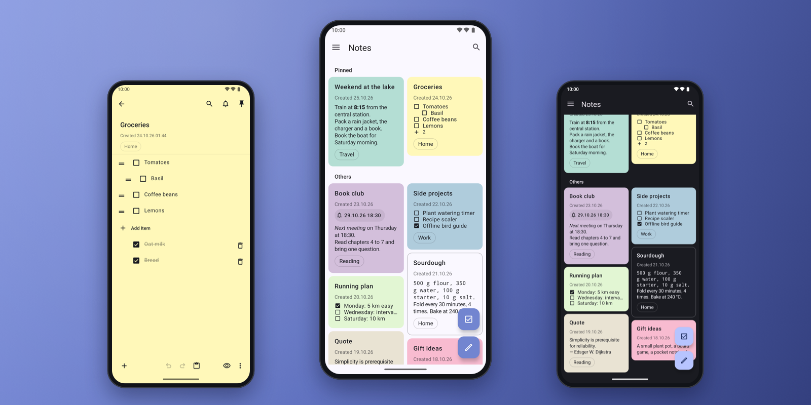

<div align="center">


# NotallyXYZ

**Notes with end-to-end encrypted sync to your own server.**<br>
NotallyX for Android, with native apps for macOS, Linux and Windows. No account, no trackers, no
Google Play Services.

[](#download)
[](#download)
[](#download)
[](https://github.com/Turtlecute33/NotallyXYZ/releases)
[](LICENSE.md)



</div>

## About

NotallyXYZ is a fork of [NotallyX](https://github.com/Crustack/NotallyX), the minimal notes app
for Android. It adds one feature: sync between your devices, through a server that you run
yourself. The server keeps only ciphertext. It never gets the key, the note text, the label names
or the file names.

This repository also has native clients for macOS (SwiftUI) and for Linux and Windows (Go and
Wails). All clients use the same [protocol](server/PROTOCOL.md). They merge changes field by
field, and keep both versions when two devices change the same text.

Sync is off by default. Without sync, the Android app is NotallyX and makes no network
connections.

## Features

- **Notes and lists**: bold, italic, monospace, strikethrough and links (also to other notes),
  lists with subtasks, colours, labels, pins, archive and bin.
- **Attachments**: images, files and audio (audio recording only on Android). They sync too,
  encrypted like the notes.
- **Reminders** with repetition, as notifications.
- **Fast sync**: a few seconds after you edit, at once while the app is open (long poll), and
  every hour in the background on Android.
- **Safe merge**: changes from two devices merge field by field. If two devices change the
  text of the same note, NotallyXYZ keeps both versions. The second copy gets the title
  "… (conflict)".
- **One key, no account**: a random sync key connects your devices. There is no user name, no
  e-mail address and no password.
- **All platforms**: Android 7 and later, macOS 26 and later (Apple silicon and Intel),
  Linux (x86_64 and aarch64) and Windows 10 and 11.
- **Your server**: one small Go binary in a Docker image. An invite token controls who can make an
  account.
- **From NotallyX** (Android): app lock with biometrics or PIN, optional database encryption,
  automatic backups, a home screen widget, and import from Google Keep, Evernote and Quillpad.

## Security

The first device makes a sync key of 256 random bits. It shows the key one time, as 14 groups of
4 characters. Keep the key in a password manager. If you lose the key and all your devices, the
data on the server cannot be decrypted.

- **Encryption on the device**: each note, label and attachment is encrypted with AES-256-GCM
  before it leaves the device. Each message gets a new random salt and its own subkey
  (HKDF-SHA256).
- **Authenticated records**: the encryption binds each record to its kind and id. The server
  cannot change a record or swap two records without detection.
- **Sealed deletions**: a deletion is also encrypted. If the server, or a person with the access
  token, makes up a deletion, the devices ignore it and upload their copy again.
- **Padded sizes**: the ciphertext is padded (Padmé, at most 12 % more), so the server does not
  see the exact length of a note.
- **No password on the server**: the devices derive an access token from the key. The server
  keeps only the SHA-256 hash of this token.
- **HTTPS only.** The Android app trusts only system CAs: a CA that you or an admin add is not
  trusted. Plain HTTP works only for a local test server.
- **Key storage**: the Android Keystore, the macOS Keychain (this device only), and Secret Service
  or the Windows Credential Manager on the desktop.
- **Encrypted local cache** on macOS, Linux and Windows: records stay sealed on disk, as on the
  server. The apps decrypt notes only in memory.
- **Same crypto on all clients**: each client must pass the test vectors in
  [`server/testvectors.json`](server/testvectors.json).
- **Hardened server**: a `scratch` image, a non-root user, a read-only file system and no Linux
  capabilities.

The server can still delete your data, hold back changes, or send an older version of a record
again. Keep a local backup on one device. The Android app makes automatic backups.

## Privacy

- No analytics, no crash reports to a server, no ads, no Google Play Services.
- The apps connect only to your sync server. With sync off, the Android app makes no network
  connections.
- The server keeps no IP addresses and writes no access logs. It sees random ids, padded sizes,
  the time of each change and the IP address of each request.
- No cookies and no HTTP cache in the sync clients. The desktop app loads no web fonts.
- No cloud backup: on Android, the database and the settings stay out of cloud backup and device
  transfer.
- **Export**: [`nxyz-export`](server/cmd/nxyz-export) downloads and decrypts all data of an
  account, for a backup or a move to another app.

## Download

Get the files from [Releases](https://github.com/Turtlecute33/NotallyXYZ/releases). Update the
server and all apps together.

| Platform | File |
|----------|------|
| Android 7 and later | `NotallyXYZ-android-<version>.apk` |
| macOS 26 and later | `NotallyXYZ-macos-<version>.dmg`, or `brew install --cask turtlecute33/tap/notallyxyz` |
| Debian and Ubuntu 22.04 or later | `notallyxyz_<version>_amd64.deb` or `notallyxyz_<version>_arm64.deb` |
| Other Linux | `NotallyXYZ-linux-x86_64-<version>.tar.gz` or `NotallyXYZ-linux-aarch64-<version>.tar.gz` |
| Windows 10 and 11 (x64) | `NotallyXYZ-windows-x64-<version>.exe` (portable) |
| Server | `ghcr.io/turtlecute33/notallyxyz-server` (amd64 and arm64) |

**Android**: before you install, check the signing certificate. Its SHA-256 fingerprint is:

```text
81776480a2afa0aced066d0b44631dd2159e267d10555a8cefcabd5c9ef9b48b
```

Compare it with the output of `apksigner verify --print-certs <file>.apk`, or use AppVerifier.
Do not install an APK with a different certificate. The package name is `com.notallyxyz`, so the
app installs next to NotallyX. To move your notes, export a backup in NotallyX (Settings →
Export backup) and import it in NotallyXYZ.

**macOS**: the app has a self-signed certificate and is not notarized. At the first start, macOS
blocks it: go to System Settings → Privacy & Security → Open Anyway. Refer to
[mac/README.md](mac/README.md).

**Linux and Windows**: refer to [desktop/README.md](desktop/README.md) for the system
requirements and the first start.

To check a download, run `shasum -a 256 -c SHA256SUMS --ignore-missing`. GitHub Actions builds the
Linux and Windows files with build provenance:
`gh attestation verify <file> -R Turtlecute33/NotallyXYZ`.

### First setup

1. Run the server with Docker. Set `SIGNUP_TOKEN` to a long random value. Refer to
   [server/README.md](server/README.md).
2. On the first device, go to Settings → Sync → Create new account. Enter the server URL and the
   token. Keep the sync key that the app shows.
3. On each other device, select Connect with sync key.
4. Optional: remove `SIGNUP_TOKEN` and start the server again. Then nobody can make new accounts.

## Build

Requirements: JDK 17 and the Android SDK with platform 36 (Android), Go 1.25 or later (server and
desktop), macOS 26 with the Command Line Tools (macOS app).

```zsh
(cd android && JAVA_HOME=/opt/homebrew/opt/openjdk@17 ./gradlew assembleDebug)
(cd server && go build .)
(cd mac && ./build-app.sh)
(cd desktop && go run github.com/wailsapp/wails/v2/cmd/wails@v2.16.0 build -tags webkit2_41 -skipbindings)   # Linux
```

For the Linux build dependencies and the Windows build, refer to
[desktop/README.md](desktop/README.md).

The release APK is about 7.6 MB. The macOS app is about 1.4 MB and has no third-party
dependencies.

<details>
<summary><b>How sync works</b></summary>

- **Keys**: HKDF-SHA256 derives three keys from the sync key: the access token, the encryption
  key and a key for ids. Label and attachment ids are HMACs of their names, so two devices that
  make the same label get one record.
- **Records**: each change gets the next number of the account. A device reads the changes after
  its last number, and the server holds the request open until a change arrives (long poll).
- **Writes**: a device sends the number of the version that it last saw. If another device
  changed the record after that version, the server rejects the write. The device then reads the
  new version, merges and tries again.
- **Merge**: a three-way merge against the last synced version. The title, the text and the list
  items are one unit. Labels and attachments merge as a union, and nothing is discarded.
- **Attachments**: a device uploads an attachment before the first note that uses it. After a
  full sync, a device can remove attachments that no note uses and that are older than 24 hours.

The full specification is in [server/PROTOCOL.md](server/PROTOCOL.md).

</details>

<details>
<summary><b>Project layout</b></summary>

- `android/`: the NotallyX fork (a git subtree). The sync code is in
  `app/src/main/java/com/philkes/notallyx/sync`.
- `server/`: the sync server (Go, bbolt), the protocol, the test vectors, `compose.yaml` and a
  `Caddyfile`. `cmd/vectors` makes the test vectors, `cmd/nxyz-export` exports an account.
- `mac/`: `Sources/NotallyCore` (crypto, storage, sync) and `Sources/NotallyXYZ` (SwiftUI).
- `desktop/`: `core/` (the Go sync client, the same rules as the macOS app) and `frontend/`
  (the web view interface).
- `release.zsh`, `update-tap.zsh`: release scripts.

</details>

<details>
<summary><b>Validation</b></summary>

```zsh
(cd server && go test -race ./... && go build -o /tmp/nxyz-android-test-server . && cp /tmp/nxyz-android-test-server /tmp/nxyz-mac-test-server)
(cd android && JAVA_HOME=/opt/homebrew/opt/openjdk@17 ./gradlew testDebugUnitTest)
(cd mac && ./test.sh)
(cd desktop && go test -race ./core/)
```

All clients check their crypto against `server/testvectors.json`. The tests also run sync end to
end against the real server: accounts, notes, labels, attachments,
conflicts, field merge, deletions, forged deletions, notes open in an editor, and the link of
equal notes at the first sync.

</details>

<details>
<summary><b>Releases</b> (maintainer)</summary>

- `./release.zsh <version>` builds the signed Android APK and the macOS disk image into
  `dist/<version>/`, with `SHA256SUMS`. The Android signing key and the macOS signing identity
  stay on the build Mac, in `~/.config/notallyxyz/`. Back up both.
- When a `v*` tag is pushed, GitHub Actions builds the Linux and Windows files
  ([desktop.yml](.github/workflows/desktop.yml)) and the server image
  ([server-image.yml](.github/workflows/server-image.yml)), and adds the desktop files to
  `SHA256SUMS` of the release.
- After the release is published, `./update-tap.zsh <version>` points the cask in
  [homebrew-tap](https://github.com/Turtlecute33/homebrew-tap) to the new disk image.
- Since 1.1.0, each deletion is sealed ([PROTOCOL.md](server/PROTOCOL.md) §5). Apps of version
  1.0.0 cannot sync deletions with a server of version 1.1.0 or later.

</details>

<details>
<summary><b>Upstream updates</b> (Android)</summary>

`android/` is a git subtree of NotallyX. To merge a new upstream version:

```zsh
git subtree pull --prefix=android https://github.com/Crustack/NotallyX.git main --squash
```

</details>

## License

NotallyXYZ is free software under the [GNU General Public License v3.0](LICENSE.md). It is based
on [NotallyX](https://github.com/Crustack/NotallyX) by Crustack, which is based on
[Notally](https://github.com/OmGodse/Notally) by OmGodse (both GPL-3.0). The server uses bbolt
(MIT). The desktop app uses Wails and go-keyring (MIT). The macOS app has no third-party code.

---

<sub>NotallyXYZ is an independent project. It is not affiliated with or endorsed by NotallyX or
its developers.</sub>
